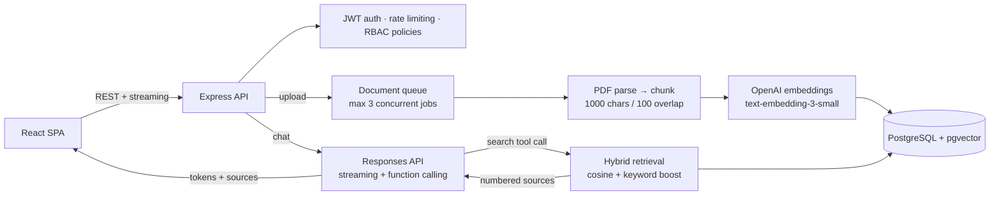
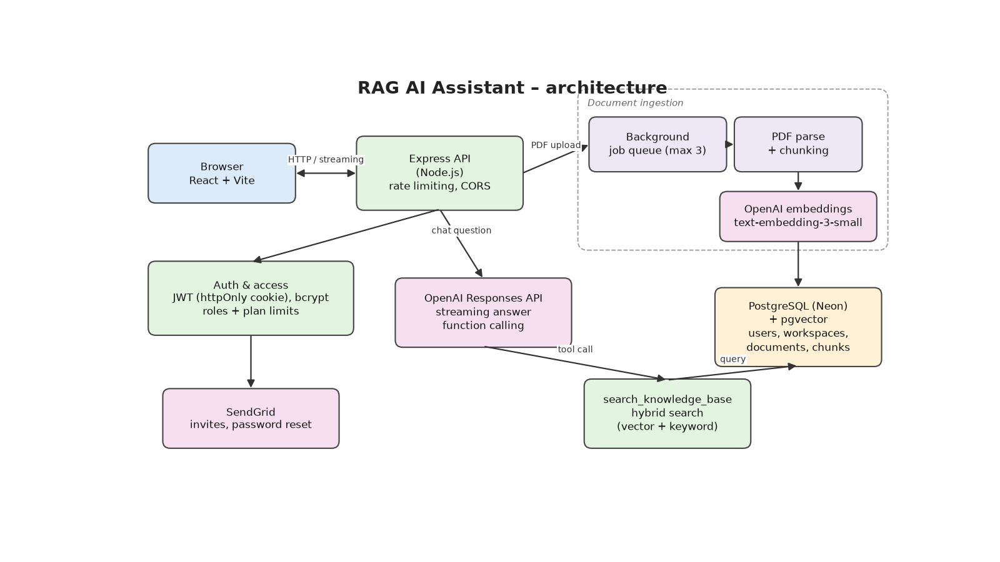

# RAGGY — RAG AI Assistant

**A multi-tenant AI knowledge assistant: teams upload their documents, and a streaming chat answers questions grounded in those documents, with numbered sources.**

Built from scratch with Node.js, React and PostgreSQL + pgvector. No LangChain or other RAG framework: chunking, embeddings, retrieval, tool calling and streaming are all hand-written.

## Demo

> _Screenshot / GIF coming soon_
>
> `docs/demo-chat.gif`: asking a question → the model calls the search tool → answer streams in with `[1] [2]` source citations
> `docs/demo-documents.png`: document upload with processing status (queued → processing → completed)
> `docs/demo-roles.png`: workspace members and roles

## Highlights

- **Tool-calling chat loop.** The model gets a `search` function via the OpenAI Responses API and decides itself *when* to search. The backend streams tokens to the browser, catches function calls mid-stream, runs the retrieval and feeds the results back as `function_call_output`. It loops until the model answers without needing another tool call.
- **Hybrid retrieval in a single SQL query.** pgvector cosine similarity plus a keyword boost (+0.3 when keywords chosen by the model match the title, category or tags). There is a similarity threshold (0.42) and the top 5 chunks are returned.
- **Grounded answers with sources.** Retrieved chunks are numbered (`[1]`, `[2]` …) before they go to the model, and the same source map is streamed to the frontend so answers can cite and link their sources. Answers render as Markdown, including images and video embeds from the sources.
- **Document ingestion pipeline.** PDFs are parsed page by page and split into ~1,000-character chunks with 100 characters of overlap. Splits fall on paragraph, line, sentence or comma boundaries, and tiny chunks are dropped. Each chunk is embedded with `text-embedding-3-small` and stored in PostgreSQL/pgvector. This runs in a background queue (max 3 concurrent jobs) inside a transaction, with per-document status (`processing` / `completed` / `failed`) and rollback on errors.
- **Multi-tenant by design.** Organisations, multiple workspaces and data scoped per organisation.
- **Role-based access control.** owner / admin / editor / viewer, enforced with small per-resource policies on the backend and feature-gating in the frontend.
- **Auth & security.** JWT in `httpOnly` cookies, bcrypt, password reset by email, global and per-route rate limiting, CORS restricted to the frontend origin, request size limits.
- **Plans & limits.** Per-plan limits for storage, members, workspaces, messages and which AI models a team may use.
- **Team invitations.** Invite members by email (SendGrid) with HTML templates.
- **Tests.** Node's built-in test runner covers the permission matrix, plan limits, cache TTL, JWT and helpers. It needs no database or API keys.

## Architecture





## Tech stack

| Layer | Technology |
|---|---|
| Frontend | React, React Router, Vite, react-markdown |
| Backend | Node.js, Express (ES modules) |
| Database | PostgreSQL (Neon serverless) + pgvector |
| AI | OpenAI Responses API (streaming, function calling), embeddings |
| Email | SendGrid |
| Auth | JWT, bcrypt, cookie-parser |
| Tests | Node.js built-in test runner |

## Project structure

```
backend/src/
├── ai-bot/          # prompts, retrieval and the streaming tool-calling loop
├── config/          # plans, model pricing, permissions
├── database/        # Neon connection
├── email-templates/ # invite and password-reset emails
├── modules/         # feature modules (controller / service / policy)
│   ├── auth/
│   ├── chat/
│   ├── connection/
│   ├── doc/         # uploads + custom multer storage engine
│   ├── invitation/
│   ├── jobs/        # PDF chunker and document processing queue
│   ├── user/
│   └── workspace/
└── server.js
backend/test/        # permission matrix, plan limits, cache, JWT
frontend/src/
├── pages/           # public pages + workspace pages (docs, people, settings…)
├── components/
├── context/
├── router/
└── styles/
```

## Getting started

**Requirements:** Node.js 20+, a PostgreSQL database with the `pgvector` extension (e.g. [Neon](https://neon.tech)), an OpenAI API key, and optionally a SendGrid key for emails.

```bash
# backend
cp .env.example .env      # in the project root, fill in your keys
cd backend && npm install
npm run dev               # http://localhost:3000

# frontend
cd frontend && cp .env.example .env
npm install
npm run dev               # http://localhost:5173

# tests (no database or API keys needed)
cd backend && npm test
```

## Design decisions & what I learned

- **No framework on purpose.** Writing chunking, retrieval and the tool-calling loop myself taught me what LangChain-style libraries hide: chunk size vs. overlap, similarity thresholds, and how to stream text while also catching function-call arguments.
- **Let the model decide when to search.** Exposing retrieval as a tool, instead of always stuffing context into the prompt, keeps small talk cheap and lets the model pick its own search keywords. Those keywords also drive the hybrid keyword boost.
- **Hybrid over pure vector search.** Embeddings miss exact terms such as product names and codes, so a cheap keyword boost in the same SQL query improves ranking without a separate search engine.
- **Authorization as small, testable policies** instead of `if` statements scattered through controllers, which is why the permission matrix can be unit-tested.
- **Slow work outside the request cycle.** Uploads return immediately, and a queue with limited concurrency does parsing and embedding, with status the UI can poll.
- **Multi-tenancy from day one.** Every query is scoped to an organisation.

## Roadmap

- Point the chat search tool at each workspace's own uploaded chunks. Org-scoped retrieval over `document_chunks` already exists in the code and still needs to be wired into the tool.
- Track token usage and cost per organisation. Model pricing is already defined in `config/`.
- Add support for more file types besides PDF.
