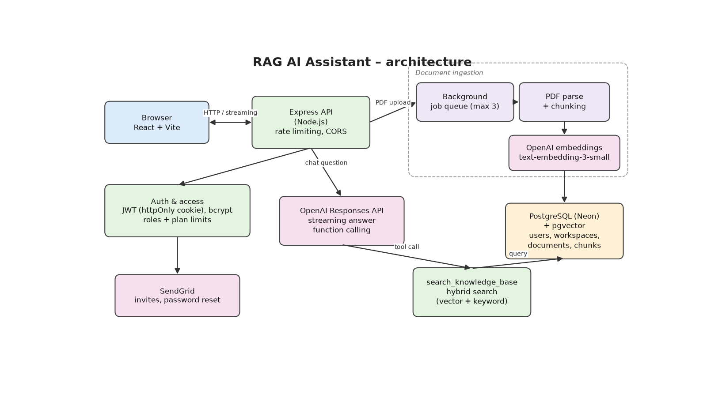

# RAG AI Assistant

A multi-tenant knowledge assistant: teams upload their own documents, and an AI chat answers questions **based on those documents** using Retrieval-Augmented Generation (RAG).

Built from scratch with Node.js, React and PostgreSQL + pgvector — no LangChain or other RAG framework.

## Architecture



## Features

- **Document ingestion pipeline** – PDF uploads are parsed per page, split into overlapping chunks, embedded with `text-embedding-3-small` and stored in PostgreSQL with **pgvector**. Processing runs in a background job queue (max 3 concurrent jobs) with status tracking per document.
- **Hybrid retrieval** – combines vector similarity (cosine distance) with keyword matching to find the most relevant chunks.
- **Streaming AI chat** – answers stream to the browser token by token via the OpenAI Responses API, with function calling so the model decides when to search the knowledge base. Answers render as Markdown, including images and video embeds from the sources.
- **Workspaces & roles** – organisations, multiple workspaces, and role-based permissions (owner / admin / editor / viewer) enforced with per-resource policies on the backend and feature-gating in the frontend.
- **Team invitations** – invite members by email (SendGrid) with HTML email templates.
- **Authentication** – JWT in `httpOnly` cookies, bcrypt password hashing, password reset by email.
- **Subscription plans** – plan limits for storage, members, workspaces, messages and allowed AI models.
- **Integrations** – per-organisation connections to external knowledge sources.
- **Security basics** – global and per-route rate limiting, CORS restricted to the frontend origin, request size limits.

## Tech stack

| Layer | Technology |
|---|---|
| Frontend | React, React Router, Vite, react-markdown |
| Backend | Node.js, Express (ES modules) |
| Database | PostgreSQL (Neon serverless) + pgvector |
| AI | OpenAI Responses API, embeddings, function calling |
| Email | SendGrid |
| Auth | JWT, bcrypt, cookie-parser |

## Project structure

```
backend/src/
├── ai-bot/          # prompts, retrieval and streaming chat logic
├── config/          # plans, model pricing, permissions
├── database/        # Neon connection
├── email-templates/ # invite and password-reset emails
├── modules/         # feature modules (controller / service / policy)
│   ├── auth/
│   ├── chat/
│   ├── connection/
│   ├── doc/         # uploads + custom multer storage engine
│   ├── invitation/
│   ├── jobs/        # PDF chunker and document processing queue
│   ├── user/
│   └── workspace/
└── server.js
frontend/src/
├── pages/           # public pages + workspace pages (docs, people, settings…)
├── components/
├── context/
├── router/
└── styles/
```

## Getting started

### Requirements
- Node.js 20+
- A PostgreSQL database with the `pgvector` extension (e.g. [Neon](https://neon.tech))
- An OpenAI API key (and optionally a SendGrid key for emails)

### Backend
```bash
cp .env.example .env      # in the project root, fill in your keys
cd backend
npm install
npm run dev               # http://localhost:3000
```

### Frontend
```bash
cd frontend
cp .env.example .env
npm install
npm run dev               # http://localhost:5173
```

## What I learned

- How RAG works under the hood: chunking strategy, overlap, embeddings and similarity thresholds
- Designing a multi-tenant data model where every query is scoped to an organisation
- Building authorization as small, testable policies instead of scattered `if` statements
- Running slow work (document processing) outside the request/response cycle

## Tests

The backend has a small test suite built on Node's built-in test runner (no extra dependencies, no database or API keys needed):

```bash
cd backend && npm install && npm test
```

It covers the role-based permission matrix and policies (owner/admin/editor/viewer for documents, invitations and members), plan limits, the in-memory cache with TTL expiry, JWT signing/verification and the utility helpers. Tests marked `TODO` document known bugs that are not fixed yet.
